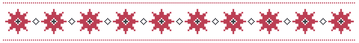

# README ornament study

Four complete README previews for `andriichuk/laravel-http-logger`:

- [Text symbols](readme-symbols.md)
- [SVG signature — proposed default](readme-svg-signature.md)
- [SVG embroidered band](readme-svg-border.md)
- [PNG signature — identical geometry to the SVG signature](readme-png-signature.md)

The proposed README uses a narrow strip above the title. These original geometric studies are inspired by Ukrainian cross-stitch embroidery; they do not claim a specific regional provenance.

## Text symbols

<p align="center">✚ ◇ ✚ ◇ ✚ ◇ ✚ ◇ ✚ ◇ ✚</p>

No image files, but glyph shape and spacing depend on the reader's font. Ordinary Markdown text cannot reliably preserve a red-and-black palette. Keep a short, single-line signature to avoid wrapping on mobile; use a fenced code block if an aligned multi-line pattern is required.

## SVG signature

<picture>
  <source media="(prefers-color-scheme: dark)" srcset="assets/vyshyvanka-signature-dark.svg">
  <source media="(prefers-color-scheme: light)" srcset="assets/vyshyvanka-signature-light.svg">
  
</picture>

Vector geometry remains sharp when enlarged. Transparent light and dark assets are selected with `picture`; the light image is the fallback for other Markdown renderers. Local assets make the signature independent of external image hosting.

## SVG embroidered band

<picture>
  <source media="(prefers-color-scheme: dark)" srcset="assets/vyshyvanka-border-dark.svg">
  <source media="(prefers-color-scheme: light)" srcset="assets/vyshyvanka-border-light.svg">
  
</picture>

A taller variation with a stitched border, using the same rosettes. It takes more vertical space before the documentation starts.

## PNG signature

<picture>
  <source media="(prefers-color-scheme: dark)" srcset="assets/vyshyvanka-signature-dark.png">
  <source media="(prefers-color-scheme: light)" srcset="assets/vyshyvanka-signature-light.png">
  
</picture>

The same geometry is exported at 1440 × 96 and displayed at up to 720 pixels wide. PNG preserves the appearance without requiring SVG support, but enlarging beyond its source dimensions eventually reveals pixels. Both PNGs have transparent backgrounds and separate light/dark palettes.

## Practical comparison

| Format | This light asset | Color control | Enlargement | Editing |
| --- | --- | --- | --- | --- |
| Text symbols | No asset | Reader's text color | Font-dependent | In README |
| SVG signature | 5,216 bytes | Explicit light/dark palettes | Vector | Readable geometry |
| PNG signature | 3,951 bytes | Explicit light/dark palettes | Fixed 1440 × 96 source | Re-export from SVG |

File size depends on the ornament: PNG can be smaller for repetitive pixel patterns. SVG is the proposed source format because its geometry is editable and scales cleanly.

## Reuse in another repository

Copy `docs/assets/vyshyvanka-signature-light.svg` and `docs/assets/vyshyvanka-signature-dark.svg`, then place this at the very start of the root README, above the title:

```html
<picture>
  <source media="(prefers-color-scheme: dark)" srcset="docs/assets/vyshyvanka-signature-dark.svg">
  <source media="(prefers-color-scheme: light)" srcset="docs/assets/vyshyvanka-signature-light.svg">
  
</picture>
```

GitHub documents theme-specific images in its [writing quickstart](https://docs.github.com/en/get-started/writing-on-github/getting-started-with-writing-and-formatting-on-github/quickstart-for-writing-on-github#adding-an-image-to-suit-your-visitors). Other renderers may use the fallback image.
